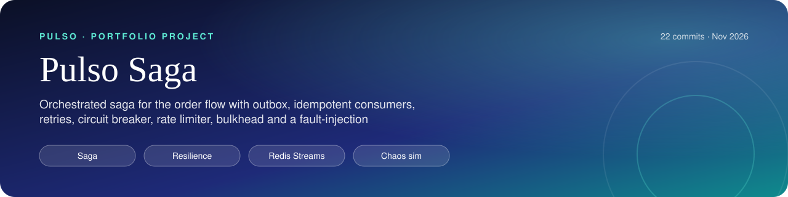
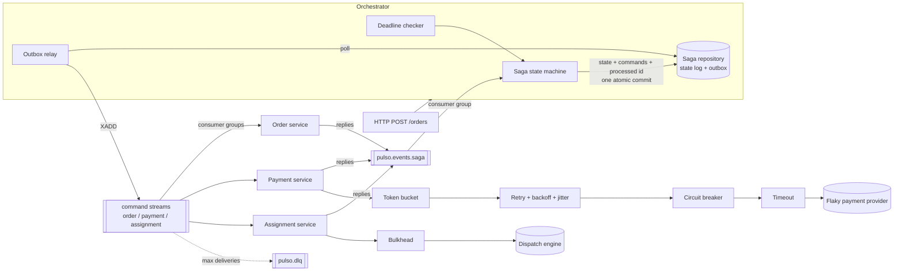
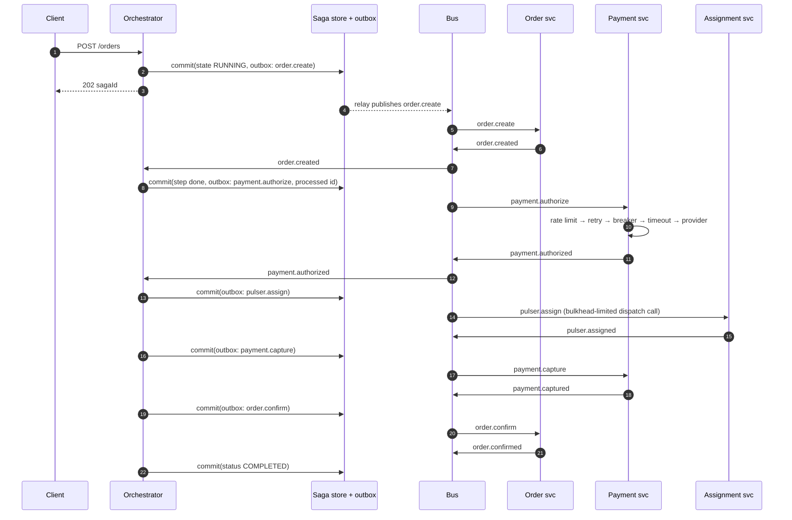
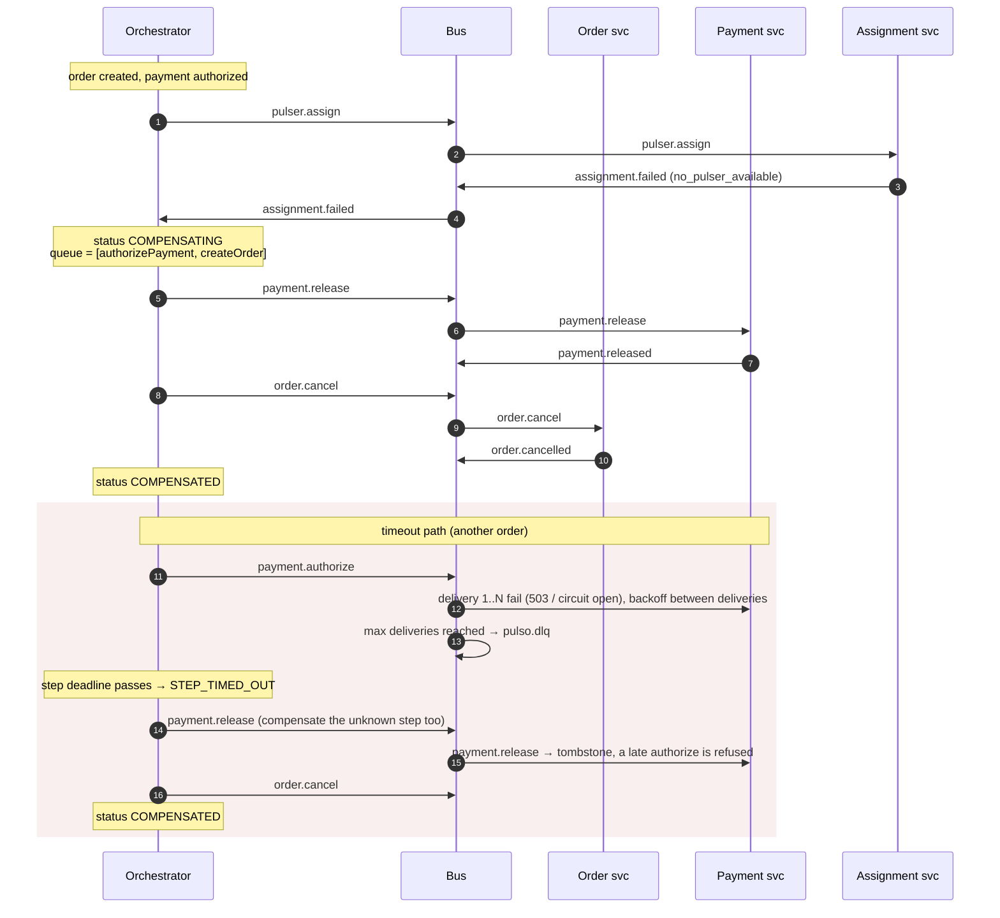

<p align="center"></p>

<p align="center"><a href="https://github.com/AlejandroAlvarez-srdev/pulso-saga/actions/workflows/ci.yml"></a>      </p>

<h1 align="center">pulso-saga</h1>
<!-- /header -->

An orchestrated **Saga** for the Pulso order flow, built to show the distributed-systems
patterns that keep a multi-service workflow correct when the network, the broker and a payment
provider all misbehave: transactional outbox, idempotent consumers, retries with exponential
backoff and jitter, dead-letter queue, circuit breaker, token-bucket rate limiter, bulkhead and
timeouts. A fault-injection simulator runs hundreds of sagas against a flaky provider and then
checks that no order holds money or a pulser it should not.

> Pulso is a fictional company used to explore these patterns: an on-demand microtask
> marketplace in LatAm where merchants post orders and independent "pulsers" fulfil them.

```
create order → authorize payment → assign pulser → capture payment → confirm order
cancel order ← release auth      ← release pulser ← refund
```

## At a glance

<table>
  <tr>
    <td align="center" width="25%"><b>65 (61 offline + Redis)</b><br>Tests</td>
    <td align="center" width="25%"><b>Breaker, backoff, bulkhead, DLQ</b><br>Patterns</td>
    <td align="center" width="25%"><b>200 sagas · 0 inconsistencies</b><br>Simulator</td>
    <td align="center" width="25%"><b>Eventual consistency, compensations</b><br>Model</td>
  </tr>
</table>

## Architecture



| Layer | Code | Notes |
| --- | --- | --- |
| Domain | `src/domain` | `Order`, `Pulser`, `Assignment` and the typed message catalogue (commands + events) |
| Bus port | `src/messaging/bus.ts` | at-least-once, consumer groups, ack, redelivery, DLQ |
| Adapters | `src/messaging/in-memory-bus.ts`, `src/infra/redis/redis-bus.ts` | in-memory (tests, simulator; can inject duplicates and reordering) and Redis Streams |
| Idempotency | `src/messaging/idempotency.ts` | claim (SET NX) → run → cache replies; duplicates replay the cached replies |
| Outbox | `src/outbox` | entries written in the saga commit; relay publishes and marks |
| Resilience | `src/resilience` | backoff, retry, timeout, circuit breaker, token bucket, bulkhead |
| Saga | `src/saga` | declarative step list, orchestrator state machine, repositories |
| Participants | `src/services` | fake order, payment (with flaky provider) and assignment services |
| Apps | `src/apps` | `orchestrator` (HTTP + loops) and `fake-services` processes for docker-compose |

## Sequence: happy path



## Sequence: failure and compensation

The assignment step fails (no pulser available). Completed steps are undone in reverse order.
The second half shows the timeout path: the authorize command is dead-lettered during a
provider outage, the saga deadline fires and the saga compensates a step whose outcome is unknown.



## Consistency model

The system is **eventually consistent**. There is no distributed transaction; each service
commits locally and the saga guarantees that every order converges to one of:

- `COMPLETED` — order `ASSIGNED`, payment `CAPTURED`, one pulser holding the task.
- `COMPENSATED` — order cancelled (or never created), no authorization or capture held
  (released or refunded), no pulser holding the task.
- `FAILED` — a compensation went unanswered after `maxCompensationAttempts` re-sends. This
  is the only state needing a human, and it is explicit in the saga log.

While a saga is in flight, other readers can observe intermediate states (an authorized
payment for an order that will be cancelled). That is the price of availability; the saga only
promises the end state.

How each hazard is handled:

| Hazard | Mechanism |
| --- | --- |
| State saved but command lost (dual write) | Transactional outbox: state, outgoing commands and the consumed message id are one atomic commit (Lua script in Redis, a single synchronous block in memory). |
| Command published twice (relay crash after publish) | Every consumer dedupes by message id. |
| Duplicate delivery to a participant | `IdempotentConsumer`: atomic claim, then cached replies are replayed with the **same ids**, so the orchestrator dedupes them too. Concurrent duplicates get `DuplicateInFlightError` and are redelivered. |
| Duplicate reply to the orchestrator | Processed-message id stored in the same commit as the state change. |
| Out-of-order / stale reply | Replies carry `causationId`; only a reply to the currently pending command advances the saga. Everything else is logged as `MESSAGE_IGNORED`. |
| Reply after the step timed out | A *late success* re-queues that step's compensation (`LATE_SUCCESS` in the log). Participants also keep tombstones (payment released, pulser released, order cancelled) so a command that arrives after its compensation is refused at the source. |
| Two writers on one saga | Optimistic concurrency (`version`); the loser throws, the bus redelivers, the retry sees the new state. |
| Provider transiently failing | Retry with exponential backoff + full jitter (in-process), then bus redelivery with backoff, then DLQ. |
| Provider down | Circuit breaker fails fast so retries do not pile up; compensations still run because releasing an authorization that never happened is a local no-op. |
| Slow dispatch engine | Bulkhead caps concurrent calls; overflow is rejected and redelivered later. |
| Unknown outcome | Timed-out steps are compensated as well; compensations are idempotent and tolerate "nothing to undo". |

The saga state keeps an append-only log (`SAGA_STARTED`, `COMMAND_SENT`, `STEP_COMPLETED`,
`STEP_FAILED`, `STEP_TIMED_OUT`, `COMPENSATION_*`, `LATE_SUCCESS`, `MESSAGE_IGNORED`, ...) which is
returned by `GET /sagas/:id`.

## Decisions and trade-offs

- **Orchestration over choreography.** The flow has a strict order and a money pivot
  (capture); one place that owns the state machine and its timeouts is easier to reason about
  and to audit than events bouncing between services. The cost is a central component, which is
  kept stateless apart from the repository so it can be scaled and restarted freely.
- **Authorize, then capture after assignment.** Money is only captured once a pulser is
  secured; the cheap compensation (void) covers most failures and refunds are only needed if
  confirmation fails after capture. The release compensation is skipped when a capture
  happened, since the refund covers it.
- **Compensate on timeout instead of retrying the step.** Retries already happen in-process
  and at the bus level; once the saga deadline passes the order is better off cancelled
  cleanly. Compensations, in contrast, are re-sent (same message id) because they must
  eventually succeed.
- **Retry layers.** In-process retries absorb blips cheaply; bus redelivery with a longer
  backoff outlives the breaker's open window; the DLQ stops poison messages from spinning
  forever. Circuit-open errors are deliberately *not* retried in-process.
- **Count-based sliding window breaker** with a minimum number of calls and a failure-rate
  threshold. Card declines do not count as failures: they are the provider working correctly.
- **Rate limiting on our side** (token bucket) keeps us under the provider quota, so we queue
  briefly instead of getting 429s that would also trip the breaker.
- **Redis Streams** gives consumer groups, a pending entries list and `XCLAIM`, enough for
  at-least-once delivery with crash recovery without running Kafka. Redelivery backoff is
  implemented by only reclaiming entries idle for longer than the backoff for their delivery
  count. For Redis Cluster the keys would need a common hash tag so the commit script stays on
  one slot.
- **Fake participants keep business state in memory.** Their messaging and dedupe go through
  Redis like real services, but `fake-services` should run as a single replica.

## Running it

Requirements: Node 24, npm. Docker for the compose setup.

```bash
npm ci
npm test              # unit + in-memory end-to-end tests (Redis tests skip without REDIS_URL)
npm run lint
npm run typecheck
npm run simulate      # fault-injection run, see below
```

With Docker:

```bash
docker compose up --build
curl -s -X POST localhost:3000/orders | jq            # starts a saga with demo order data
curl -s localhost:3000/sagas/<sagaId> | jq '.status, .log'
```

`fake-services` reads `PAYMENT_FAILURE_RATE`, `PAYMENT_TIMEOUT_RATE`, `PAYMENT_DECLINE_RATE`,
`MERCHANT_WITHDRAW_RATE` and `PULSERS`; the orchestrator reads `STEP_TIMEOUT_MS` and
`MAX_COMPENSATION_ATTEMPTS`.

Redis integration tests (they `FLUSHDB`, use a throwaway instance):

```bash
docker compose up -d redis
REDIS_URL=redis://localhost:6379 npm test
```

## Fault-injection simulator

`scripts/simulate.ts` wires the complete in-memory system (outbox relay, bus with 10 %
duplicate deliveries and reordering jitter, idempotent consumers, retries, breaker, DLQ, saga
deadlines) and runs N sagas against a provider that fails, hangs and declines at configurable
rates, with an optional total-outage window. At the end it verifies the consistency invariants
and exits non-zero on any violation or stuck saga, so CI runs it as a smoke test.

```bash
npm run simulate -- --sagas 200 --fail 0.2 --timeout 0.05 --decline 0.05 --outage 1000-2500
```

Default run:

```
Pulso saga — fault-injection run
  200 sagas | provider: 20.0% 5xx, 5.0% hang, 5.0% decline | merchant withdraw 3.0%
  outage: 100% 5xx from 1000ms to 2500ms
  bus: 10.0% duplicate deliveries, up to 3ms reorder jitter | seed 2026 | 13023ms

Outcomes
  completed                               166  83.0%
  compensated                              34  17.0%
    authorizePayment: timeout              19
    authorizePayment: card_declined        10
    confirmOrder: merchant_withdrew         5
  failed (manual action)                    0  0.0%
  still running                             0
  dead-lettered deliveries                 20  19 distinct commands: payment.authorize=20

Resilience
  provider calls                          528
    5xx injected                          138
    hangs injected (timed out)             33
  in-process retries                      162
  circuit breaker transitions              28  CLOSED->OPEN=6 OPEN->HALF_OPEN=11 HALF_OPEN->CLOSED=6 HALF_OPEN->OPEN=5
  saga steps timed out                     19
  late successes compensated                0
  stale replies ignored                     0
  compensations re-sent                     0

Consistency
  OK: every completed saga is ASSIGNED + CAPTURED; no compensated saga holds money or a pulser
```

A harsher run (`--fail 0.35 --timeout 0.1 --outage 500-6000`) shows the breaker doing its job:
the provider sees only 156 calls for 200 sagas, 164 commands go to the DLQ, 83 % of sagas are
compensated — and the consistency check still passes.

The seed fixes the fault rolls, but scheduling runs on real timers, so numbers move between
runs (the default run lands between ~80 % and ~95 % completed on a laptop, sometimes with zero
dead letters when the redelivery chain outlasts the outage).

## Tests

65 tests (61 run without Redis, 4 Redis integration tests run in CI against a Redis service):

- `test/resilience` — circuit breaker transitions (closed → open → half-open → closed / re-open,
  trial-call limit, business errors ignored), backoff growth, caps and jitter bounds, retry
  policy, token bucket refill and waiting, bulkhead limits, timeouts with abort.
- `test/messaging` — consumer groups, backlog delivery, redelivery and dead-lettering,
  duplicate injection; idempotent consumer under duplicates, in-flight duplicates and failures.
- `test/outbox` — ordered relay, broker failure, crash between publish and mark.
- `test/saga` — happy path, every compensation path (decline, no pulser, confirm failure after
  capture, provider outage → DLQ → timeout), duplicates on every delivery, reordering, late
  success after timeout, stale replies, compensation re-send → `FAILED`, optimistic concurrency.
- `test/services` — payment pipeline (retry, decline, tombstones, release racing authorize) and
  assignment scoring, capacity and bulkhead rejection.
- `test/integration` — Redis Streams ack / PEL reclaim / DLQ, Lua commit, dedupe store and a
  full saga over Redis.

## What this demonstrates

- Designing a saga with explicit compensations, a pivot step and a persisted, auditable state log.
- Transactional outbox and idempotent consumers to get effectively-once processing on top of
  at-least-once delivery.
- Handling duplicates, reordering, late replies and races with causation ids, tombstones and
  optimistic concurrency.
- Layered resilience: timeouts, retries with exponential backoff and jitter, circuit breaker,
  token-bucket rate limiting, bulkheads and a dead-letter queue — and knowing which errors
  belong to which layer.
- A port/adapter message bus with an in-memory adapter for fast deterministic tests and a Redis
  Streams adapter (consumer groups, ack, pending re-claim) for real deployments.
- Fault injection with invariant checks as evidence of resilience, not just happy-path tests.
- Strict TypeScript, typed message catalogue, lint, CI and container build.

## License

MIT © 2026 Alejandro Álvarez
